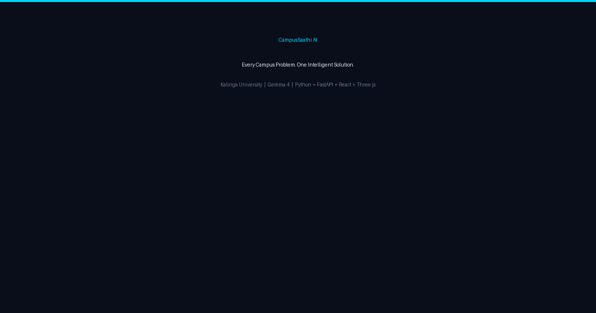

# CampusSaathi AI — Kalinga University Smart Campus

> **Every Campus Problem. One Intelligent Solution.**

An AI-powered smart campus platform for **Kalinga University, Raipur**, built at **MLH Hack Day, IIT Bhilai** using **Gemma 4** (`gemma-4-26b-a4b-it`) via the Gemini API.



---

## Overview

Students at Kalinga University face daily friction with no unified digital channel to:

- Report campus problems (canteen, hostel, washrooms, labs, transport) and track their resolution
- Get quick, reliable answers about campus facilities without hunting through multiple websites
- Understand complex university notices that bury key dates and action items in dense text
- Access an interactive campus map before physically exploring the campus

CampusSaathi AI addresses these problems with a single platform powered by **Gemma 4**, an open-weight multimodal model from Google, accessed through the Gemini API.

**Intended users:** Students of Kalinga University, Raipur (MVP scope). The architecture is designed to generalise to any university campus.

**Important:** CampusSaathi is a hackathon MVP. It is **not** officially integrated with Kalinga University systems. Complaints are stored locally. AI responses are general guidance, not official university decisions. The 3D campus model is illustrative and does not represent verified campus geometry.

---

## Feature Status

| Feature | Status | Verification method | Remaining limitations |
|---|---|---|---|
| AI Campus Assistant | **Implemented & tested** | `tests/test_chat_fix.py` — real Gemma 4 call | Answers based on Gemma's training data; no live university data feed |
| Gradio message-format fix | **Implemented & tested** | `tests/test_chat_regression.py` — full round-trip | — |
| Complaint submission + AI analysis | **Implemented & tested** | `tests/_test_backend.py` | Stored locally; not sent to university staff |
| Complaint tracking & status update | **Implemented & tested** | `tests/_test_backend.py` | Demo admin key only |
| Live Dashboard | **Implemented & tested** | `tests/_test_backend.py` | Reflects local JSON data only |
| Smart Notice Summarizer (text) | **Implemented & tested** | `tests/_test_backend.py` | AI may miss context not in the pasted text |
| Smart Notice Summarizer (image) | **Implemented** | Manual — requires image upload | OCR quality depends on image clarity |
| Interactive 3D Campus Explorer | **Implemented** | Manual — WebGL in Chrome/Edge | Illustrative model; not verified geometry |
| Voice Assistant (speech → Gemma → TTS) | **Implemented** | Manual — Chrome/Edge required | Browser Web Speech API; not Firefox/Safari |
| Gradio fallback app | **Implemented & tested** | `python campus_saathi/app.py` | Separate from React frontend |
| PostgreSQL migration | **Planned** | — | Currently JSON only |
| Official university data integration | **Planned** | — | Requires university API access |
| Push notifications | **Planned** | — | — |

---

## Technology Stack

| Layer | Technology | Version (tested) |
|---|---|---|
| AI Model | Gemma 4 (`gemma-4-26b-a4b-it`) via Gemini API | — |
| AI SDK | `google-genai` | 2.29.0 |
| AI Client | `gemma_client.py` (caching, retries, rate-limit) | — |
| Backend | Python + FastAPI + uvicorn | FastAPI 0.143.0 |
| Gradio fallback | Gradio | 6.30.0 |
| Frontend | React + TypeScript + Vite | React 19, Vite 8 |
| 3D | Three.js + React Three Fiber + Drei | Three.js 0.169 |
| Charts | Recharts | 2.x |
| Styling | Tailwind CSS | 3.4 |
| Persistence | JSON (MVP) | — |
| Python | CPython | 3.11.9 |
| Node.js | — | 24.18.0 |
| npm | — | 11.16.0 |

**Third-party licenses:** React (MIT), Three.js (MIT), FastAPI (MIT), Gradio (Apache 2.0), Recharts (MIT), Tailwind CSS (MIT), Lucide React (ISC), Axios (MIT), google-genai (Apache 2.0). Inter font via Google Fonts (OFL). No third-party assets with incompatible licenses are included.

---

## Architecture

```
gemma_client.py          ← Shared Gemma 4 client (caching, retries, rate limiting)
backend/
  main.py                ← FastAPI REST API — all AI + data endpoints
campus_saathi/
  app.py                 ← Gradio fallback app (works independently)
  ai.py                  ← AI functions: chat, complaint analysis, notice summarizer
  data.py                ← JSON persistence (complaint CRUD + dashboard stats)
  theme.py               ← Gradio CSS theme
frontend/
  src/
    components/
      CampusExplorer.tsx ← Interactive 3D campus (React Three Fiber)
      Navbar.tsx
      Footer.tsx
    pages/
      HomePage.tsx       ← Landing page with hero + 3D scene
      AssistantPage.tsx  ← AI chat interface
      VoicePage.tsx      ← Voice assistant (speech recognition + TTS)
      GrievancesPage.tsx ← Complaint submit + track + admin update
      DashboardPage.tsx  ← Analytics dashboard (Recharts)
      NoticesPage.tsx    ← Notice summarizer (text + image)
      ExplorePage.tsx    ← Full-page 3D explorer
      AboutPage.tsx      ← Project info and tech stack
    api.ts               ← Typed API client (axios, proxied to :8000)
skills/
  campus_saathi.json     ← Agent Skill metadata
  campus-saathi/
    SKILL.md             ← Agent Skill Open Standard skill file
tests/
  test_gemma_diagnostic.py  ← Gemma 4 live connection diagnostic
  test_chat_fix.py          ← Chat pipeline test (real Gemma call)
  test_chat_regression.py   ← Gradio message-format regression test
  _test_backend.py          ← FastAPI endpoint tests (requires backend running)
  _test_data.py             ← Persistence layer unit tests
  _test_imports.py          ← Import checks
data/
  complaints.json        ← Persisted complaints (git-ignored)
```

### Request flow (React frontend)

```
Browser → Vite dev proxy (/api) → FastAPI :8000
  POST /api/chat        → ai.campus_chat() → gemma_client.GemmaChat.send_message()
  POST /api/complaints  → ai.analyze_complaint() → gemma_client.ask()
  POST /api/notices/summarize → ai.summarize_notice() → gemma_client.ask()
  GET  /api/dashboard   → data.dashboard_stats()
```

### Gemma 4 integration

The model is called exclusively through `gemma_client.py`:

```python
# gemma_client.py — the one line that calls Gemma 4
_client = genai.Client(api_key=key)
response = _client.models.generate_content(model="gemma-4-26b-a4b-it", contents=prompt)
```

The client adds:
- Rate-limit spacing (configurable via `MIN_SECONDS_BETWEEN_CALLS`)
- Automatic retries on HTTP 429 / 500 / 503
- On-disk response cache (skips duplicate API calls)
- Usage counter (24-hour rolling, soft limit warning)
- Safe error messages that never print the API key

**Limitations:** Gemma 4 does not have access to live Kalinga University data. It answers from its training knowledge. Opening hours, prices, contact numbers and official policies must be verified at [kalingauniversity.ac.in](https://www.kalingauniversity.ac.in).

---

## Prerequisites

- Python **3.11+** (tested on 3.11.9)
- Node.js **18+** (tested on 24.18.0)
- npm **9+** (tested on 11.16.0)
- A free **Gemini API key** from [aistudio.google.com](https://aistudio.google.com)
- Chrome or Edge for the Voice Assistant (Web Speech API requirement)

---

## How to run

### 1 — Get a free Gemini API key

Visit [aistudio.google.com](https://aistudio.google.com), sign in, and create an API key. The free tier is sufficient for development.

### 2 — Clone and set up Python (Windows PowerShell)

```powershell
git clone https://github.com/RudraDudhat2509/gemma4-starter.git
cd gemma4-starter

python -m venv .venv
.venv\Scripts\Activate.ps1
pip install -r requirements.txt
```

If `Activate.ps1` is blocked by execution policy:

```powershell
Set-ExecutionPolicy -ExecutionPolicy RemoteSigned -Scope CurrentUser
```

### 3 — Configure environment variables

```powershell
Copy-Item .env.example .env
```

Open `.env` and replace `paste-your-key-here` with your actual key:

```
GEMINI_API_KEY=your-actual-key-here
```

Never commit `.env`. It is protected by `.gitignore`.

### 4 — Verify Gemma 4 connection

```powershell
python tests/test_gemma_diagnostic.py
```

Expected output:
```
1. API key present: YES (value hidden)
2. Client initialized: OK
3. Model response received: GEMMA_OK
4. Model used: gemma-4-26b-a4b-it
DIAGNOSTIC_PASS
```

### 5 — Start the backend

```powershell
uvicorn backend.main:app --reload --port 8000
```

Backend: http://127.0.0.1:8000
API docs: http://127.0.0.1:8000/docs

### 6 — Start the frontend (separate terminal)

```powershell
cd frontend
npm install
npm run dev
```

Frontend: http://localhost:5173

The Vite dev server proxies all `/api` requests to the FastAPI backend on port 8000.

### Alternative — Gradio fallback (no Node.js required)

```powershell
python campus_saathi/app.py
```

Open http://127.0.0.1:7860. This runs the full Gradio application independently of the React frontend.

---

## Running tests

```powershell
# Activate venv first
.venv\Scripts\Activate.ps1

# Gemma 4 live connection diagnostic (requires API key + internet)
python tests/test_gemma_diagnostic.py

# Chat pipeline — makes a real Gemma 4 call
python tests/test_chat_fix.py

# Gradio message-format regression (no API call needed)
python tests/test_chat_regression.py

# Data layer unit tests (no API call needed)
python tests/_test_data.py

# Import checks (no API call needed)
python tests/_test_imports.py

# FastAPI endpoint tests (requires backend running on :8000)
python tests/_test_backend.py

# Official submission checker
python tools/check_submission.py
```

**Distinguishing test types:**
- `test_gemma_diagnostic.py`, `test_chat_fix.py` — **real Gemma API calls** — require `GEMINI_API_KEY` and internet
- `test_chat_regression.py`, `_test_data.py`, `_test_imports.py` — **offline unit tests** — no API key needed
- `_test_backend.py` — **integration tests** — require the FastAPI backend running

**Frontend build check:**

```powershell
cd frontend
npm run build
```

---

## API routes

All routes are prefixed `/api`. The Vite proxy forwards them to `http://127.0.0.1:8000`.

| Method | Route | Description |
|---|---|---|
| GET | `/api/health` | Returns `{"status":"ok","model":"gemma-4-26b-a4b-it"}` |
| POST | `/api/chat` | Send a message; body: `{"message":"...","history":[]}` |
| POST | `/api/chat/reset` | Clear the server-side chat session |
| GET | `/api/complaints/categories` | Returns category and status lists |
| POST | `/api/complaints` | Submit a complaint (AI-analyzed) |
| GET | `/api/complaints/{id}` | Get a complaint by ID |
| PATCH | `/api/complaints/{id}/status` | Update status (requires `admin_key`) |
| GET | `/api/complaints` | List complaints with optional filters |
| GET | `/api/dashboard` | Dashboard stats from persisted data |
| POST | `/api/notices/summarize` | Summarize notice text |
| POST | `/api/notices/summarize-image` | Summarize notice image (PNG/JPEG/WEBP) |

Example request (dummy data):

```bash
curl -X POST http://127.0.0.1:8000/api/chat \
  -H "Content-Type: application/json" \
  -d '{"message": "What are the library timings?", "history": []}'
```

---

## Troubleshooting

**`GEMINI_API_KEY` missing or invalid**
```
Problem: No API key found. Fix: copy .env.example to .env ...
```
Copy `.env.example` to `.env` and set your key. Get a free key at [aistudio.google.com](https://aistudio.google.com).

**`Model not found` error**
The model name is `gemma-4-26b-a4b-it`. Check `GEMMA_MODEL` in `.env` is not overriding it with a wrong value.

**`Too many requests` (HTTP 429)**
The free tier has per-minute and per-day limits. `gemma_client.py` retries automatically with backoff. Wait a minute and try again. Do not share one key between multiple people simultaneously.

**Frontend build fails**
```powershell
cd frontend
npm install   # ensure node_modules are present
npm run build
```
Requires Node.js 18+. Check `node --version`.

**Gradio message-format error**
`Data incompatible with messages format. Each message should be a dictionary with 'role' and 'content' keys`
This was the original bug. It is fixed in `campus_saathi/ai.py` via `_normalize_history()`. Run `python tests/test_chat_regression.py` to verify.

**Backend not reachable from frontend**
Ensure `uvicorn backend.main:app --reload --port 8000` is running before starting `npm run dev`. The Vite proxy requires the backend on port 8000.

**Voice Assistant not working**
The Web Speech API requires Chrome or Edge. Firefox and Safari do not support `SpeechRecognition` on all platforms. A text input fallback is always available on the `/voice` page.

**`Activate.ps1` blocked on Windows**
```powershell
Set-ExecutionPolicy -ExecutionPolicy RemoteSigned -Scope CurrentUser
```

---

## Security and data handling

- The API key is read from `.env` at runtime. It is never logged, printed, returned in API responses, or committed to git.
- `.env` is listed in `.gitignore`. Run `git ls-files .env` to confirm it is not tracked.
- Complaints are stored in `data/complaints.json` on the local machine. This file is git-ignored.
- No real student personal data is collected. The complaint form does not ask for names, student IDs, or contact details.
- The admin status-update endpoint requires an `admin_key` (default: `demo-admin` for the MVP). Change `ADMIN_KEY` in `.env` for any real deployment.
- No audio is sent to any server. The Voice Assistant uses browser-native speech recognition; only the resulting text transcript is sent to the backend.

---

## Agent Skill

The Agent Skill is located at `skills/campus-saathi/SKILL.md` and follows the Agent Skill Open Standard format (name, description in YAML frontmatter, Markdown instructions). The legacy JSON metadata is preserved at `skills/campus_saathi.json`.

See `docs/AGENT_SKILL_NOTES.md` for notes on the standard. Validate with `skills-ref validate ./skills/campus-saathi` if the `skills-ref` CLI is available.

---

## Official Kalinga University links

These links are official university resources. CampusSaathi is not affiliated with or endorsed by Kalinga University.

- 🌐 [Kalinga University](https://www.kalingauniversity.ac.in)
- 🏛️ [Campus Facilities](https://www.kalingauniversity.ac.in/campus-facilities)
- 📋 [Grievance Redressal](https://kalingauniversity.ac.in/grievance-redressal)
- 🎥 [Official 360° Virtual Tour](https://virtualtour.kalingauniversity.ac.in/)

*Links last verified: July 2025. External URLs may change without notice.*

---

## Known limitations

- Complaint data is stored in a local JSON file. It is not shared with university staff.
- AI answers are based on Gemma 4's training data, not live university systems.
- The 3D campus model is illustrative. Building positions and labels are not verified.
- The Voice Assistant requires Chrome or Edge.
- The free Gemini API tier has rate limits. Heavy use may trigger HTTP 429 errors.
- No authentication or user accounts — this is a single-user MVP.
- Image OCR quality depends on the clarity of the uploaded notice image.

---

## License

MIT License — see [LICENSE](LICENSE).

Copyright (c) 2025 CampusSaathi Team — MLH Hack Day, IIT Bhilai.

This project is not affiliated with, endorsed by, or a product of Kalinga University or Google.

Third-party components retain their own licenses (see Technology Stack section above).

---

## Contributing

This is a hackathon project. If you fork it:

1. Copy `.env.example` to `.env` and add your own Gemini API key.
2. Never commit `.env` or any file containing a real API key.
3. Run `python tools/check_submission.py` before submitting.
4. Keep AI responses clearly labelled as AI-generated suggestions.
5. Do not claim official university affiliation without authorization.

To report a security issue, open a GitHub issue marked `[SECURITY]` or contact the repository owner directly. Do not post API keys or credentials in issues.
